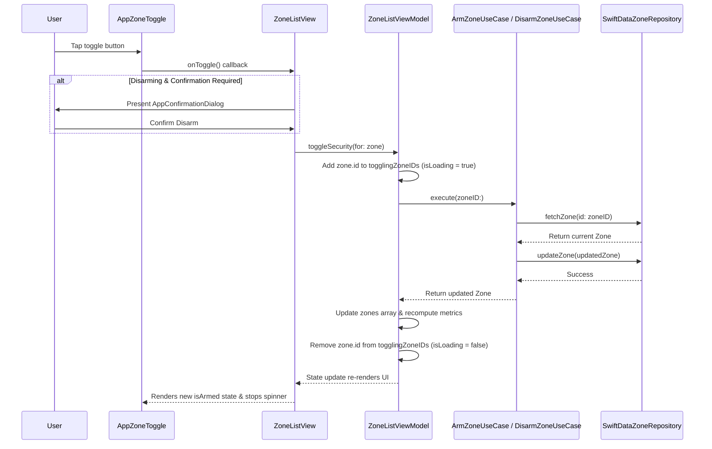

# Security Monitoring Companion — Architecture Specification

This document details the architectural design, layer boundaries, SwiftUI component library, data flow, concurrency patterns, persistence strategy, and testing methodologies implemented in the **Security Monitoring Companion (`SecurityCompanionDemo`)**.

---

## 1. Architectural Philosophy & Layer Overview

The application is structured according to **Clean Architecture** principles, prioritizing testability, maintainability, strict decoupling between business logic and UI frameworks, and a reusable, prop-driven component presentation layer.

### Compile-Time Dependencies vs. Runtime Invocation Flow

A foundational principle of Clean Architecture is **Dependency Inversion**: the inner Domain layer has zero dependencies on any external framework or outer layer.

#### Compile-Time Dependency Structure
Both the Presentation layer and the Data layer depend inward on the Domain layer:

```
┌────────────────────────────────────────────────────────────────────────┐
│                           Presentation Layer                           │
│   SwiftUI Views  •  @Observable ViewModels (@MainActor)               │
│   Reusable Component Library (AppCard, AppBadge, AppButton, etc.)      │
└───────────────────────────────────┬────────────────────────────────────┘
                                    │ depends on (calls Use Cases & observes state)
                                    ▼
┌────────────────────────────────────────────────────────────────────────┐
│                              Domain Layer                              │
│   Entities  •  Repository Protocols  •  Use Cases                      │
│       (Pure Swift Value Types • Zero External Dependencies)            │
└───────────────────────────────────▲────────────────────────────────────┘
                                    │ depends on (implements Repository Protocols)
                                    │
┌───────────────────────────────────┴────────────────────────────────────┐
│                               Data Layer                               │
│   SwiftData Repositories (@ModelActor) • URLSession                    │
│   DTOs & Deterministic Mappers • Persistent Cache                      │
└────────────────────────────────────────────────────────────────────────┘
```

#### Runtime Interaction Flow
At runtime, execution flows unidirectionally from user interactions in the Presentation layer, through Domain use cases, to Data repositories assembled by the dependency injection root (`AppContainer`):

```
User Action ──► SwiftUI View ──► ViewModel ──► Use Case ──► Repository Protocol ──► Concrete Repository
```

### Layer Responsibilities

1. **`App` (`SecurityCompanionDemo/App`)**
   - Application lifecycle entry point (`SecurityCompanionDemoApp`).
   - Dependency Injection root (`AppContainer`).
   - Manages the persistence container (`ModelContainer`), coordinates startup seed tasks, and dispenses ViewModels to views.

2. **`Core` (`SecurityCompanionDemo/Core`)**
   - Cross-cutting concerns and design tokens (`Theme/AppTheme.swift`).
   - Semantic colors, spacing scale, corner radii, and opacity constants shared across components.

3. **`Domain` (`SecurityCompanionDemo/Domain`)**
   - The authoritative core of the system. Contains zero references to SwiftUI, SwiftData, or `URLSession`.
   - **Entities (`Entities/`):** Pure Swift value types (`Zone`, `Sensor`, `SecurityEvent`).
   - **Enums (`Enums/`):** Strongly typed domain states (`SecurityState`, `SensorStatus`, `SensorType`, `EventSeverity`, `EventType`).
   - **Repository Protocols (`Repositories/`):** Abstractions defining persistence and retrieval contracts (`ZoneRepository`, `EventRepository`).
   - **Use Cases (`UseCases/`):** Single-responsibility business interaction logic (`ArmZoneUseCase`, `DisarmZoneUseCase`, `GetZonesUseCase`, `GetEventsUseCase`).
   - **Errors (`DomainError.swift`):** Domain failure cases (`notFound`, `alreadyArmed`, `alreadyDisarmed`).

4. **`Data` (`SecurityCompanionDemo/Data`)**
   - Concrete implementations of domain repository protocols.
   - **Local (`Local/Models`):** SwiftData persistent entities (`ZoneModel`, `SensorModel`, `SecurityEventModel`).
   - **Remote (`Remote/`):** Data Transfer Objects (`PostDTO`) and deterministic mapping engines (`SecurityEventMapper`).
   - **Repositories (`Repositories/`):** `SwiftDataZoneRepository`, `PersistentEventRepository`, `RemoteEventRepository`, and `InMemoryZoneRepository`.
   - **Data Errors (`DataError.swift`):** Infrastructure-specific errors (`networkUnavailable`, `invalidResponse`, `decodingFailed`, `zoneNotFound`).

5. **`Presentation` (`SecurityCompanionDemo/Presentation`)**
   - User interface rendered with SwiftUI, state observation, and a standalone prop-driven component library.
   - Organized by feature: `Components/`, `Authentication/`, `Zones/`, `Events/`, `Settings/`.
   - ViewModels conform to the modern Swift Observation framework (`@Observable`) and are isolated to `@MainActor` to ensure UI thread safety.
   - Views compose reusable design components (`AppCard`, `AppBadge`, `AppZoneToggle`, `AppButton`, `AppBanner`, `AppConfirmationDialog`).

---

## 2. Domain Entities, Repositories & Use Cases

### Domain Entities (Swift Value Types)

- **`Zone`**: Represents a physical security partition (e.g., "Front Entry & Porch", "Living Room"). Contains an array of child `Sensor` entities.
  ```swift
  struct Zone: Identifiable, Sendable, Equatable {
      let id: UUID
      var name: String
      var state: SecurityState
      var sensors: [Sensor]
  }
  ```
- **`Sensor`**: Represents an individual sensor device attached to a zone.
  ```swift
  struct Sensor: Identifiable, Sendable, Equatable {
      let id: UUID
      var name: String
      var type: SensorType           // doorContact, motion, glassBreak, temperature, smoke
      var status: SensorStatus       // online, warning, offline, triggered, tampered
      var batteryLevel: Int          // 0 to 100
  }
  ```
- **`SecurityEvent`**: Represents a timestamped simulated security telemetry record.
  ```swift
  struct SecurityEvent: Identifiable, Sendable, Equatable {
      let id: String
      let title: String
      let description: String
      let timestamp: Date
      let severity: EventSeverity    // info, warning, critical
      let type: EventType            // motionDetected, doorOpened, systemArmed, systemDisarmed, sensorOffline, lowBattery
      let zoneName: String?
  }
  ```

### Repository Protocols

Repository protocols are defined in the Domain layer and conform to `Sendable`:

```swift
nonisolated protocol ZoneRepository: Sendable {
    func fetchZones() async throws -> [Zone]
    func updateZone(_ zone: Zone) async throws
    func fetchZone(id: UUID) async throws -> Zone?
}

nonisolated protocol EventRepository: Sendable {
    func fetchEvents() async throws -> [SecurityEvent]
}
```

### Use Cases & Business Rules

Use cases encapsulate fine-grained business logic as stateless, `Sendable` structs:
- **`GetZonesUseCase`**: Fetches all monitored zones from the configured `ZoneRepository`.
- **`ArmZoneUseCase`**:
  1. Retrieves zone by `UUID` via `zoneRepository.fetchZone(id:)`. Throws `DomainError.notFound` if missing.
  2. Asserts current state is `.disarmed`. Throws `DomainError.alreadyArmed` if already armed.
  3. Mutates state to `.armed` and commits update via `zoneRepository.updateZone(_:)`.
  4. Returns the updated `Zone`.
- **`DisarmZoneUseCase`**:
  1. Retrieves zone by `UUID` via `zoneRepository.fetchZone(id:)`. Throws `DomainError.notFound` if missing.
  2. Asserts current state is `.armed`. Throws `DomainError.alreadyDisarmed` if already disarmed.
  3. Mutates state to `.disarmed` and commits update via `zoneRepository.updateZone(_:)`.
  4. Returns the updated `Zone`.
- **`GetEventsUseCase`**: Queries events through the `EventRepository` abstraction (which coordinates remote synchronization and local cache fallback).

---

## 3. Dependency Injection & `AppContainer`

Dependency injection is managed centrally via the **Composition Root** pattern in `AppContainer`.

```swift
@MainActor
final class AppContainer {
    let modelContainer: ModelContainer?
    let zoneRepository: ZoneRepository
    let eventRepository: EventRepository
    let getZonesUseCase: GetZonesUseCase
    let armZoneUseCase: ArmZoneUseCase
    let disarmZoneUseCase: DisarmZoneUseCase
    let getEventsUseCase: GetEventsUseCase
    let sessionManager: AuthSessionManager
    let preferences: UserPreferences

    private(set) var seedTask: Task<Void, Error>?
    ...
}
```

### Implementation Details of `AppContainer`:
1. **Shared Instance Properties:** Repositories (`zoneRepository`, `eventRepository`) and use cases (`getZonesUseCase`, `armZoneUseCase`, `disarmZoneUseCase`, `getEventsUseCase`) are long-lived shared instances stored on the container, not global singletons.
2. **Optional Persistence Container:** `modelContainer: ModelContainer?` is optional. In the production initializer, it holds the persistent `ModelContainer`. In the flexible/testing initializer, it can be `nil` or an in-memory container.
3. **Injected Session & Preferences:** `sessionManager` and `preferences` default to their respective `.shared` instances but can be injected with custom instances for isolated testing.
4. **Initial Seeding & Concurrency Coordination:** In the production initializer, `AppContainer` initiates sample data seeding via `seedTask`:
   ```swift
   self.seedTask = Task {
       try await zoneRepo.seedInitialDataIfNeeded(sampleZones: AppContainer.sampleZones)
   }
   ```
   The container exposes `ensureDataSeeded() async { _ = try? await seedTask?.value }`. The dashboard view awaits this on cold launch before calling `loadZones()`, preventing an empty-state race condition.
5. **Mandatory Use-Case Injection:** `makeZoneListViewModel()` requires non-optional `armZoneUseCase` and `disarmZoneUseCase` dependencies.
6. **Factory Methods:** Exposes factory functions to instantiate ViewModels with required use cases:
   - `makeZoneListViewModel() -> ZoneListViewModel`
   - `makeZoneDetailViewModel(zone: Zone) -> ZoneDetailViewModel`
   - `makeEventListViewModel() -> EventListViewModel`
   - `makeSettingsViewModel() -> SettingsViewModel`
7. **Testing Initializer:** Provides an overloaded initializer `init(zoneRepository:eventRepository:modelContainer:sessionManager:preferences:)` accepting custom repositories (e.g. `InMemoryZoneRepository` or mock actors) where `seedTask` is `nil`, allowing isolated unit and preview testing without persistent disk side-effects.

---

## 4. SwiftUI Component Library & Design System

The application features a standalone, reusable, prop-driven SwiftUI component library located in `SecurityCompanionDemo/Presentation/Components/` and styled using design tokens defined in `SecurityCompanionDemo/Core/Theme/AppTheme.swift`.

### 4.1 Design Tokens (`AppTheme`)

All components reference centralized design constants in `AppTheme`:
- **Corner Radii (`AppTheme.CornerRadius`):**
  - `small: 8pt` — Banners, compact chips.
  - `medium: 12pt` — Buttons, modal surfaces.
  - `card: 14pt` — Standard cards (`AppCard`).
  - `large: 16pt` — Sheet containers.
- **Spacing Scale (`AppTheme.Spacing`):**
  - `extraSmall: 4pt`, `small: 8pt`, `medium: 12pt`, `cardPadding: 16pt`, `section: 20pt`.
- **Semantic Colors (`AppTheme.Colors`):**
  - `success`: `Color.green` (Armed states, online sensors).
  - `warning`: `Color.orange` (Low battery warnings, partially armed states).
  - `critical`: `Color.red` (Offline sensors, destructive disarm actions).
  - `info`: `Color.blue` (Informational alerts, primary actions).
  - `neutral`: `Color.secondary` (Disarmed states, bypassed sensors).
  - `cardBackground`: `Color(uiColor: .secondarySystemGroupedBackground)` (Adapts to Light/Dark mode).
  - `screenBackground`: `Color(uiColor: .systemGroupedBackground)`.
- **Opacities (`AppTheme.Opacity`):**
  - `subtleBackground: 0.12`, `mediumBackground: 0.15`, `borderStroke: 0.25`.

### 4.2 Reusable Component Catalog

| Component | Responsibility | Public Initializer / Props | State & Behavior | Integration Site |
| :--- | :--- | :--- | :--- | :--- |
| **`AppCard`** | Surface container providing elevation, padding, and optional accent borders. | `init(padding: CGFloat = 16, cornerRadius: CGFloat = 14, borderColor: Color? = nil, @ViewBuilder content: () -> Content)` | Stateless container. Uses continuous corner clipping and optional stroke overlay for state highlighting. | `ZoneCardView`, `EventRowView` |
| **`AppBadge`** | Standardized semantic pill badge for states, sensor health, and severities. | `init(_ text: String, iconName: String? = nil, style: AppBadgeStyle = .neutral, isSmall: Bool = false, showDot: Bool = false)` | Stateless prop-driven pill. Scalable Dynamic Type text styles, single-line clipping with fixed horizontal sizing. | `ZoneCardView`, `EventRowView` |
| **`AppButton`** | Standardized action button supporting visual variants, loading spinners, and full-width layouts. | `init(_ title: String, iconName: String? = nil, variant: AppButtonVariant = .primary, isLoading: Bool = false, isEnabled: Bool = true, isFullWidth: Bool = true, cornerRadius: CGFloat = 8, action: @escaping () -> Void)` | Handles taps via callback. Enforces minimum 44pt touch target height. Replaces label with `ProgressView` when `isLoading` is true. | `LoginView` (Sign In), `ZoneDetailView` (Arm/Disarm), `SettingsView` (Sign Out), `ZoneListView` (Retry), `EventListView` (Retry) |
| **`AppBanner`** | Contextual alert and status banner supporting icons, bold titles, and dismiss controls. | `init(title: String? = nil, message: String, style: AppBannerStyle = .info, iconName: String? = nil, onDismiss: (() -> Void)? = nil)` | Renders a tinted notification surface. Independent accessibility element for dismiss button with 44pt touch target. | `ZoneListView` (error banner), `ZoneDetailView` (error banner), `EventListView` (simulation notice & pull-to-refresh error banner) |
| **`AppConfirmationDialog`** | View modifier standardizing modal confirmation dialogs for critical actions. | `appConfirmationDialog(title: String, message: String, confirmTitle: String, confirmRole: ButtonRole? = .destructive, cancelTitle: String = "Cancel", isPresented: Binding<Bool>, onConfirm: @escaping () -> Void)` | Attached to view hierarchies. Presents native `.confirmationDialog` with distinct confirm and cancel action roles. | `ZoneListView` (disarm confirmation), `ZoneDetailView` (disarm confirmation), `SettingsView` (sign-out confirmation) |
| **`AppZoneToggle`** | Dedicated toggle control for arming and disarming security zones. | `init(isArmed: Bool, isLoading: Bool = false, isEnabled: Bool = true, onToggle: @escaping () -> Void)` | Callback-only toggle. Does NOT directly mutate domain models. Shows animated `ProgressView` when `isLoading` is true. Enforces 44pt touch target. | `ZoneCardView` |

### 4.3 Screen Integration & Component Composition

The component library is composed into the primary application screens:

1. **Dashboard (`ZoneCardView`):**
   - Composed inside an `AppCard` whose `borderColor` highlights green when `zone.state == .armed`.
   - Divided into a two-tier layout:
     - **Top Tier:** Zone navigation button containing a circular status icon, zone name, sensor count, and a right chevron. Exposes one unified accessibility element (`cardAccessibilityLabel`).
     - **Bottom Tier:** Metadata stack containing an `AppBadge` for armed/disarmed status, conditional warning `AppBadge`s (e.g. `OFFLINE`, `LOW BATT`), and the interactive `AppZoneToggle`.
2. **Event History (`EventRowView`):**
   - Composed inside an `AppCard` with severity-accented border strokes for critical and warning events.
   - Displays event type icon, event headline, timestamp, and an `AppBadge` with a leading colored indicator dot reflecting event severity (`INFO`, `WARNING`, `CRITICAL`).
3. **Dashboard Host (`ZoneListView`):**
   - Hosts `AppBanner` for transient operation failure messages.
   - Attaches `.appConfirmationDialog` to enforce safety confirmations before executing disarm use cases.

### 4.4 Unidirectional Data Flow & Business Rule Decoupling

Components are strictly presentation-driven and callback-only:
- `AppZoneToggle` does not mutate `Zone` entities or communicate with `ZoneRepository`.
- When a user taps `AppZoneToggle`, it invokes its `onToggle` closure.
- `ZoneListView` receives the callback and checks user preferences (`container.preferences.requireDisarmConfirmation`).
  - If disarming requires confirmation: Presents `.appConfirmationDialog`.
  - Upon confirmation (or if confirmation is disabled/arming): Invokes `viewModel.toggleSecurity(for: zone)`.
- `ZoneListViewModel` verifies that the zone is not already loading (`togglingZoneIDs`), marks the zone ID as loading, and delegates directly to `ArmZoneUseCase` or `DisarmZoneUseCase`.
- The use case fetches the current zone from `ZoneRepository.fetchZone(id:)`, enforces domain rules (e.g. throwing `DomainError.alreadyArmed` if state mismatch occurs), and commits changes via `ZoneRepository.updateZone(_:)`.
- The ViewModel catches errors, updates dashboard UI state, and removes the zone from `togglingZoneIDs`.



### 4.5 Accessibility Considerations

The component library was designed with accessibility considerations in mind:
- **Minimum 44pt Touch Targets:** `AppButton`, `AppZoneToggle`, and the dismiss control in `AppBanner` enforce `.frame(minWidth: 44, minHeight: 44)` with rectangular hit-testing content shapes.
- **Dynamic Type Scalability:** Component typography uses system text styles (`.headline`, `.subheadline`, `.footnote`, `.caption`, `.caption2`) with `.weight(...)` rather than fixed-point fonts, allowing text to scale with user accessibility settings.
- **VoiceOver Element Grouping & Separation:**
  - In `ZoneCardView`, the top navigation region is combined into a single accessible button (`.accessibilityElement(children: .ignore)`), preventing fragmented VoiceOver stops. The `AppZoneToggle` remains an independent accessible control with `.accessibilityLabel("Arm zone" / "Disarm zone")`, `.accessibilityValue("Armed" / "Disarmed")`, and `.accessibilityHint("Double tap to toggle security state")`.
  - In `AppBanner`, the text contents are combined into one accessibility label, while the optional dismiss button remains an independently operable element with `.accessibilityLabel("Dismiss message")`.
  - In `AppBadge`, children are ignored in favor of a clean, localized accessibility label (e.g. `"ARMED status"`).

---

## 5. Local Persistence with SwiftData

Local storage is implemented using Apple's **SwiftData** framework, targeting iOS 17+.

### SwiftData Models & Relationships

- **`ZoneModel`**:
  - Primary entity representing persisted zones.
  - `@Attribute(.unique) var id: UUID` ensures unique identity.
  - `@Relationship(deleteRule: .cascade, inverse: \SensorModel.zone) var sensors: [SensorModel]` establishes a one-to-many relationship with automatic cascade deletion of child sensors when a zone is deleted.
- **`SensorModel`**:
  - Persists individual sensor configurations and telemetry.
  - `@Attribute(.unique) var id: UUID`.
  - Belongs to an optional parent zone: `var zone: ZoneModel?`.
- **`SecurityEventModel`**:
  - Persists cached activity feed records.
  - `@Attribute(.unique) var id: String`.

### Actor Isolation in Repositories

To manage persistence thread safety and prevent `ModelContext` access across concurrent threads, `SwiftDataZoneRepository` is implemented as an `@ModelActor`:
```swift
@ModelActor
actor SwiftDataZoneRepository: ZoneRepository { ... }
```
`PersistentEventRepository` also conforms to `ModelActor`:
```swift
actor PersistentEventRepository: ModelActor, EventRepository { ... }
```
`InMemoryZoneRepository` is implemented as an actor:
```swift
actor InMemoryZoneRepository: ZoneRepository { ... }
```
`RemoteEventRepository` is implemented as an immutable, `Sendable` class:
```swift
final class RemoteEventRepository: EventRepository, Sendable { ... }
```
This isolates database mutations to each actor's dedicated executor, separating persistence operations from the `@MainActor` UI thread.

---

## 6. Remote API Integration & Offline Fallback Strategy

### Remote Data Source (JSONPlaceholder)

The app integrates with the public [JSONPlaceholder](https://jsonplaceholder.typicode.com/) REST API:
- **Endpoint:** `GET https://jsonplaceholder.typicode.com/posts?_limit=15`
- Executed via `URLSession.shared.data(from:)` with structured `async/await`.

### DTO Mapping (`SecurityEventMapper`)

Because JSONPlaceholder returns placeholder posts (`PostDTO`), the application employs a deterministic mapper to convert these responses into simulated security events:
- **Deterministic Event Types:** Derived from `abs(post.id) % eventTypes.count` (Motion Detected, Door Opened, System Armed, System Disarmed, Sensor Offline, Low Battery).
- **Deterministic Severity:** Calculated based on event type and ID modulo rules (e.g. sensor offline is always `.critical`; motion/door events alternate between `.info` and `.warning`).
- **Simulated Timestamps:** Anchored to a stable reference point with staggered intervals per post ID.

> [!NOTE]
> All activity events and zone telemetry are simulated. The application does not connect to live physical security hardware.

### Two-Tier Offline Fallback Architecture

The event feed is managed by `PersistentEventRepository`, which coordinates remote fetching and SwiftData caching:
1. **Online Success:** Remote events are fetched, upserted into SwiftData (overwriting existing IDs without duplicates), and returned to the UI sorted newest-first.
2. **Offline Fallback:** If `URLSession` throws a network error (no connection, timeout, lost connection), the repository catches the error and queries local `SecurityEventModel` records. If cached events exist, they are returned immediately, allowing the user to browse recent activity without disruption.
3. **Double Failure:** If the network is down AND local cache is empty, the network error is propagated to the ViewModel to display an error state with a "Try Again" retry action.

---

## 7. ViewModels, Observation & Concurrency Choices

### Modern Observation Framework

All ViewModels use SwiftUI's modern `@Observable` macro (iOS 17+) rather than legacy `ObservableObject` / `@Published`:
- Fine-grained property observation: SwiftUI only re-renders views that access specific mutated properties.
- Passed cleanly into subviews using `@Bindable` when two-way binding is required.

### Concurrency Configuration

- **Build Settings:** The project compiles under **Swift 5.0** language mode in Xcode 16.0 with `SWIFT_APPROACHABLE_CONCURRENCY = YES`, `SWIFT_DEFAULT_ACTOR_ISOLATION = MainActor`, and `SWIFT_UPCOMING_FEATURE_MEMBER_IMPORT_VISIBILITY = YES`.
- **`@MainActor` ViewModels:** `ZoneListViewModel`, `ZoneDetailViewModel`, `EventListViewModel`, and `SettingsViewModel` are isolated to `@MainActor` to ensure UI state modifications execute on the main thread.
- **Actor-Isolated Repositories:** `SwiftDataZoneRepository`, `PersistentEventRepository`, and `InMemoryZoneRepository` run on separate actors/executors, offloading persistence I/O from the UI.
- **Value-Type Message Passing (`Sendable`):** Domain entities, enums, use cases, and DTOs conform to `Sendable` to support safe boundary crossing across actor boundaries.

---

## 8. Business Rule Enforcement & Test Coverage

### Arm / Disarm Rule Enforcement
1. **Idempotence & Safety:** Zones cannot be armed if already armed, and cannot be disarmed if already disarmed.
2. **Sensor Independence:** Business rules dictate that security state (`armed` vs `disarmed`) remains decoupled from sensor health. A zone with an offline sensor or low battery can still be armed by design, while the UI highlights the warning to the user.
3. **Duplicate Request Protection:** `ZoneListViewModel` tracks ongoing operations in `togglingZoneIDs: Set<UUID>`. Tapping a toggle for a zone already in-flight is safely ignored without duplicate use-case invocations.

### Verification via Automated Test Suites

The test suite consists of **67 automated tests: 65 unit tests across five unit test suites, plus 2 UI tests in a separate UI test target** (all 67 passing):

#### Five Unit Test Suites (65 Unit Tests)

1. **`SecurityCompanionDemoTests.swift` (24 Unit Tests):**
   - Tests `GetZonesUseCase` (success, failure propagation, empty state).
   - Tests `ArmZoneUseCase` (happy path, `alreadyArmed` rejection, `notFound` handling).
   - Tests `DisarmZoneUseCase` (happy path, `alreadyDisarmed` rejection, `notFound` handling).
   - Tests overall security status aggregation (all armed, all disarmed, partially armed, empty).
   - Tests sensor thresholds (battery $\le 20\%$ triggers attention, offline status).
   - Tests zone state independence from sensor health.
   - **`ZoneListViewModel` Component & Concurrency Integration Tests:**
     - Successful arm operation updates dashboard state and metric counts.
     - Successful disarm operation updates dashboard state and metric counts.
     - Failed repository update preserves existing state and surfaces operation error message.
     - Scoped `isZoneLoading(_:)` state is cleared upon successful completion.
     - Scoped `isZoneLoading(_:)` state is cleared upon operation failure.
     - Concurrency test with `GatedZoneRepository` verifying that duplicate toggle requests on an in-flight zone are safely ignored.
2. **`EventFeedTests.swift` (22 Unit Tests):**
   - Tests `RemoteEventRepository` with mocked `URLSession` protocols.
   - Tests HTTP status code handling (200 OK, 404, 500) and network disconnects.
   - Tests JSON decoding from `PostDTO`.
   - Tests `SecurityEventMapper` determinism, severity mapping, and date ordering.
   - Tests `EventListViewModel` state transitions (`idle` $\rightarrow$ `loading` $\rightarrow$ `loaded` / `error`).
   - Tests pull-to-refresh transient error banner dismissal.
3. **`ZonePersistenceTests.swift` (7 Unit Tests):**
   - Tests SwiftData insertion and retrieval of zones.
   - Tests retrieving zones by `UUID` using `#Predicate`.
   - Tests updating armed/disarmed state and saving to disk.
   - Tests cascade deletion of child `SensorModel` records.
   - Tests data survival across `ModelContainer` reloads.
   - Tests initial seed logic execution only when empty.
4. **`EventPersistenceTests.swift` (5 Unit Tests):**
   - Tests SwiftData event insertion and retrieval.
   - Tests upsert logic (updating existing event ID without duplicating).
   - Tests returning cached events when remote network fails.
   - Tests error propagation when both network and cache are unavailable.
   - Tests reverse-chronological sorting of cached events.
5. **`SettingsAndAuthTests.swift` (7 Unit Tests):**
   - Tests default user preferences.
   - Tests preference persistence across application relaunches using isolated `UserDefaults`.
   - Tests `AuthSessionManager` sign-in and sign-out lifecycle.
   - Tests disarm confirmation evaluation logic.
   - Tests sensor warning visibility preference toggling.
   - Tests sign-out preserving persisted zones and events in SwiftData.
   - Tests `SettingsViewModel` actions and metadata formatting.

#### Separate UI Test Target (2 UI Tests)

6. **`SecurityCompanionDemoUITests.swift` (2 UI Tests):**
   - `testExample()`: Verifies application launch and initial window hierarchy presentation.
   - `testLaunchPerformance()`: Measures application launch performance metrics using `XCTApplicationLaunchMetric()`.
