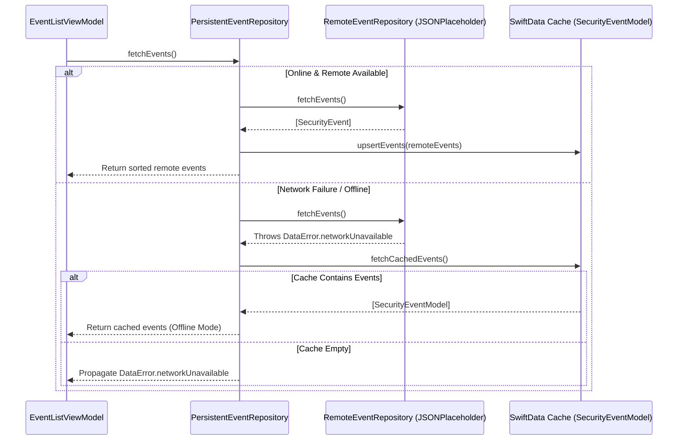

# Security Monitoring Companion — Architecture Specification

This document details the architectural design, layer boundaries, data flow, concurrency patterns, persistence strategy, and testing methodologies implemented in the **Security Monitoring Companion (`SecurityCompanionDemo`)**.

---

## 1. Architectural Philosophy & Layer Overview

The application is structured according to **Clean Architecture** principles, prioritizing testability, maintainability, and strict decoupling between business logic and framework-specific implementations.

```
┌────────────────────────────────────────────────────────┐
│                   Presentation Layer                   │
│   SwiftUI Views  •  @Observable ViewModels (@MainActor)│
└───────────────────────────▲────────────────────────────┘
                            │ (Calls Use Cases / Observes State)
┌───────────────────────────┴────────────────────────────┐
│                      Domain Layer                      │
│   Entities  •  Repository Protocols  •  Use Cases      │
│          (Pure Swift • Zero External Dependencies)     │
└───────────────────────────▲────────────────────────────┘
                            │ (Implements Protocols)
┌───────────────────────────┴────────────────────────────┐
│                       Data Layer                       │
│   SwiftData Repositories (@ModelActor) • URLSession    │
│   DTOs & Deterministic Mappers • Persistent Cache      │
└────────────────────────────────────────────────────────┘
```

### Layer Responsibilities

1. **`App` (`SecurityCompanionDemo/App`)**
   - Application lifecycle entry point (`SecurityCompanionDemoApp`).
   - Dependency Injection root (`AppContainer`).
   - Initializes long-lived shared singletons, persistence containers (`ModelContainer`), and seeds initial sample records.

2. **`Core` (`SecurityCompanionDemo/Core`)**
   - Cross-cutting concerns and global design tokens (`Theme/`).
   - Reusable colors, typography standards, and styling constants shared across presentation modules.

3. **`Domain` (`SecurityCompanionDemo/Domain`)**
   - The authoritative core of the system. Contains zero references to SwiftUI, SwiftData, or `URLSession`.
   - **Entities (`Entities/`):** Pure Swift immutable or value-type models (`Zone`, `Sensor`, `SecurityEvent`).
   - **Enums (`Enums/`):** Strongly typed domain states (`SecurityState`, `SensorStatus`, `SensorType`, `EventSeverity`, `EventType`).
   - **Repository Protocols (`Repositories/`):** Abstractions defining persistence and retrieval contracts (`ZoneRepository`, `EventRepository`).
   - **Use Cases (`UseCases/`):** Single-responsibility business interaction logic (`ArmZoneUseCase`, `DisarmZoneUseCase`, `GetZonesUseCase`, `GetEventsUseCase`).
   - **Errors (`DomainError.swift`):** Enterprise domain failure modes (`notFound`, `alreadyArmed`, `alreadyDisarmed`).

4. **`Data` (`SecurityCompanionDemo/Data`)**
   - Concrete implementations of domain repository protocols.
   - **Local (`Local/Models`):** SwiftData persistent entities (`ZoneModel`, `SensorModel`, `SecurityEventModel`).
   - **Remote (`Remote/`):** Data Transfer Objects (`PostDTO`) and deterministic mapping engines (`SecurityEventMapper`).
   - **Repositories (`Repositories/`):** `SwiftDataZoneRepository`, `PersistentEventRepository`, `RemoteEventRepository`, and `InMemoryZoneRepository`.
   - **Data Errors (`DataError.swift`):** Infrastructure-specific errors (`networkUnavailable`, `invalidResponse`, `decodingFailed`, `zoneNotFound`).

5. **`Presentation` (`SecurityCompanionDemo/Presentation`)**
   - User interface rendered with SwiftUI and state observation.
   - Organized by feature: `Authentication/`, `Zones/`, `Events/`, `Settings/`.
   - ViewModels conform to the modern Swift Observation framework (`@Observable`) and are pinned to the `@MainActor` to ensure UI thread safety.

---

## 2. Domain Entities, Repositories & Use Cases

### Domain Entities

- **`Zone`**: Represents an armed/disarmed physical partition (e.g., "Front Entry & Porch", "Living Room"). Contains an array of child `Sensor` entities.
  ```swift
  struct Zone: Identifiable, Sendable, Equatable {
      let id: UUID
      var name: String
      var state: SecurityState
      var sensors: [Sensor]
  }
  ```
- **`Sensor`**: Represents an individual IoT telemetry device attached to a zone.
  ```swift
  struct Sensor: Identifiable, Sendable, Equatable {
      let id: UUID
      var name: String
      var type: SensorType           // doorContact, motion, glassBreak, temperature, smoke
      var status: SensorStatus       // online, warning, offline, triggered, tampered
      var batteryLevel: Int          // 0 to 100
  }
  ```
- **`SecurityEvent`**: Represents a timestamped security telemetry event.
  ```swift
  struct SecurityEvent: Identifiable, Sendable, Equatable {
      let id: String
      let title: String
      let description: String
      let timestamp: Date
      let severity: EventSeverity    // info, warning, critical
      let type: EventType            // motionDetected, doorOpened, systemArmed, systemDisarmed, sensorOffline, lowBattery
      let zoneName: String?
  }
  ```

### Repository Protocols

```swift
protocol ZoneRepository: Sendable {
    func fetchZones() async throws -> [Zone]
    func fetchZone(id: UUID) async throws -> Zone?
    func updateZone(_ zone: Zone) async throws
}

protocol EventRepository: Sendable {
    func fetchEvents() async throws -> [SecurityEvent]
}
```

### Use Cases & Business Rules

Use cases encapsulate fine-grained business logic and are stateless, `Sendable` structs:
- **`GetZonesUseCase`**: Fetches all monitored zones from the configured repository.
- **`ArmZoneUseCase`**:
  1. Retrieves zone by `UUID`. Throws `DomainError.notFound` if missing.
  2. Asserts current state is `.disarmed`. Throws `DomainError.alreadyArmed` if already armed.
  3. Mutates state to `.armed` and commits update via `zoneRepository.updateZone(_:)`.
- **`DisarmZoneUseCase`**:
  1. Retrieves zone by `UUID`. Throws `DomainError.notFound` if missing.
  2. Asserts current state is `.armed`. Throws `DomainError.alreadyDisarmed` if already disarmed.
  3. Mutates state to `.disarmed` and commits update via `zoneRepository.updateZone(_:)`.
- **`GetEventsUseCase`**: Queries events through the `EventRepository` abstraction (which automatically coordinates remote synchronization and local cache fallback).

---

## 3. Dependency Injection & `AppContainer`

Dependency injection is managed centrally via the **Composition Root** pattern in `AppContainer`.

```swift
@MainActor
final class AppContainer {
    let modelContainer: ModelContainer?
    let zoneRepository: ZoneRepository
    let eventRepository: EventRepository
    let getZonesUseCase: GetZonesUseCase
    let armZoneUseCase: ArmZoneUseCase
    let disarmZoneUseCase: DisarmZoneUseCase
    let getEventsUseCase: GetEventsUseCase
    let sessionManager: AuthSessionManager
    let preferences: UserPreferences
    ...
}
```

### Responsibilities of `AppContainer`:
1. **Container Lifecycle:** Instantiates the primary `ModelContainer` configured for `ZoneModel`, `SensorModel`, and `SecurityEventModel`.
2. **Initial Seeding:** Checks the persistent store on startup and seeds 4 realistic initial zones (`sampleZones`) if the store is empty.
3. **Repository Wiring:** Injects `modelContainer` into `SwiftDataZoneRepository` and `PersistentEventRepository`.
4. **Factory Methods:** Exposes factory functions to instantiate ViewModels with required use cases (`makeZoneListViewModel()`, `makeZoneDetailViewModel(zone:)`, `makeEventListViewModel()`, `makeSettingsViewModel()`).
5. **Testing Flexibility:** Provides an overloaded initializer accepting custom repositories and an in-memory `ModelContainer` for automated tests and SwiftUI previews without touching persistent disk storage.

---

## 4. Local Persistence with SwiftData

Local storage is implemented using Apple's **SwiftData** framework, targeting iOS 17+.

### SwiftData Models & Relationships

- **`ZoneModel`**:
  - Primary entity representing persisted zones.
  - `@Attribute(.unique) var id: UUID` ensures unique identity.
  - `@Relationship(deleteRule: .cascade, inverse: \SensorModel.zone) var sensors: [SensorModel]` establishes a one-to-many relationship with automatic cascade deletion of child sensors when a zone is deleted.
- **`SensorModel`**:
  - Persists individual sensor configurations and telemetry.
  - `@Attribute(.unique) var id: UUID`.
  - Belongs to an optional parent zone: `var zone: ZoneModel?`.
- **`SecurityEventModel`**:
  - Persists cached activity feed records.
  - `@Attribute(.unique) var id: String`.

### ModelActor Thread Safety

To guarantee concurrency safety and prevent `ModelContext` access across concurrent threads, `SwiftDataZoneRepository` is implemented as an `@ModelActor`:
```swift
@ModelActor
actor SwiftDataZoneRepository: ZoneRepository { ... }
```
This isolates database mutations to the actor's dedicated executor, eliminating data races between background tasks and the UI thread.

> [!NOTE]
> **Schema Migration Strategy Note:** The application currently relies on SwiftData's default lightweight schema handling. No custom `SchemaMigrationPlan` or staged versioned migration models are implemented at this stage.

---

## 5. Remote API Integration & Offline Fallback Strategy

### Remote Data Source (JSONPlaceholder)

The app integrates with the free public [JSONPlaceholder](https://jsonplaceholder.typicode.com/) REST API:
- **Endpoint:** `GET https://jsonplaceholder.typicode.com/posts?_limit=15`
- Executed via `URLSession.shared.data(from:)` with structured `async/await`.

### DTO Mapping (`SecurityEventMapper`)

Because JSONPlaceholder returns generic placeholder posts (`PostDTO(userId:id:title:body)`), the application employs a deterministic mapper to convert these responses into domain-accurate security telemetry:
- **Deterministic Event Types:** Derived from `abs(post.id) % eventTypes.count` (Motion Detected, Door Opened, System Armed, System Disarmed, Sensor Offline, Low Battery).
- **Deterministic Severity:** Calculated based on event type and ID modulo rules (e.g. sensor offline is always `.critical`; motion/door events alternate between `.info` and `.warning`).
- **Simulated Timestamps:** Anchored to a stable reference point (Nov 24, 2026 UTC) with 15-minute staggered intervals per post ID.
- **Realistic Event Prose:** Transforms raw body text into contextual messages (e.g., "Motion sensor in Living Room triggered", "Front Door Contact opened").

### Two-Tier Offline Fallback Architecture

The event feed is managed by `PersistentEventRepository`, which coordinates remote fetching and SwiftData caching:



1. **Online Success:** Remote events are fetched, upserted into SwiftData (overwriting existing IDs without duplicates), and returned to the UI sorted newest-first.
2. **Offline Fallback:** If `URLSession` throws a network error (no connection, timeout, lost connection), the repository catches the error and queries local `SecurityEventModel` records. If cached events exist, they are returned immediately, allowing the user to browse recent activity without disruption.
3. **Double Failure:** If the network is down AND local cache is empty, the network error is propagated to the ViewModel to display an actionable error screen with a "Try Again" retry action.

---

## 6. ViewModels, Observation & Concurrency Choices

### Modern Observation Framework

All ViewModels use SwiftUI's modern `@Observable` macro (iOS 17+) rather than legacy `ObservableObject` / `@Published`:
- Fine-grained property observation: SwiftUI only re-renders views that access specific mutated properties.
- Passed cleanly into subviews using `@Bindable` when two-way binding is required.

### Concurrency Guarantees

- **`@MainActor` ViewModels:** `ZoneListViewModel`, `ZoneDetailViewModel`, `EventListViewModel`, and `SettingsViewModel` are isolated to `@MainActor` to ensure UI state modifications execute on the main thread.
- **Actor-Isolated Repositories:** `SwiftDataZoneRepository` and `PersistentEventRepository` run on separate actors/executors, offloading persistence I/O from the UI.
- **Strict Concurrency Safety (`Sendable`):** Domain entities, enums, use cases, and DTOs conform to `Sendable`, ensuring zero data race warnings under Swift 6 strict concurrency checks.

---

## 7. Business Rule Enforcement & Test Coverage

### Arm / Disarm Rule Enforcement
1. **Idempotence & Safety:** Zones cannot be armed if already armed, and cannot be disarmed if already disarmed.
2. **Sensor Independence:** Business rules dictate that security state (`armed` vs `disarmed`) remains decoupled from sensor health. A zone with an offline sensor or low battery can still be armed by design, while the UI highlights the warning to the user.

### Verification via Automated Test Suites

The test suite consists of **59 unit tests** and **2 UI tests** (61 total tests) across 5 test files:

1. **`SecurityCompanionDemoTests.swift` (18 Tests):**
   - Tests `GetZonesUseCase` (success, failure propagation, empty state).
   - Tests `ArmZoneUseCase` (happy path, `alreadyArmed` rejection, `notFound` handling).
   - Tests `DisarmZoneUseCase` (happy path, `alreadyDisarmed` rejection, `notFound` handling).
   - Tests overall security status aggregation (all armed, all disarmed, partially armed, empty).
   - Tests sensor thresholds (battery < 20% triggers attention, offline status).
   - Tests zone state independence from sensor health.
2. **`EventFeedTests.swift` (22 Tests):**
   - Tests `RemoteEventRepository` with mocked `URLSession` protocols.
   - Tests HTTP status code handling (200 OK, 404, 500) and network disconnects.
   - Tests JSON decoding from `PostDTO`.
   - Tests `SecurityEventMapper` determinism, severity mapping, and date ordering.
   - Tests `EventListViewModel` state transitions (`idle` $\rightarrow$ `loading` $\rightarrow$ `loaded` / `error`).
   - Tests pull-to-refresh transient error banner dismissal.
3. **`ZonePersistenceTests.swift` (7 Tests):**
   - Tests SwiftData insertion and retrieval of zones.
   - Tests retrieving zones by `UUID` using `#Predicate`.
   - Tests updating armed/disarmed state and saving to disk.
   - Tests cascade deletion of child `SensorModel` records.
   - Tests data survival across `ModelContainer` reloads.
   - Tests initial seed logic execution only when empty.
4. **`EventPersistenceTests.swift` (5 Tests):**
   - Tests SwiftData event insertion and retrieval.
   - Tests upsert logic (updating existing event ID without duplicating).
   - Tests returning cached events when remote network fails.
   - Tests error propagation when both network and cache are unavailable.
   - Tests reverse-chronological sorting of cached events.
5. **`SettingsAndAuthTests.swift` (7 Tests):**
   - Tests default user preferences.
   - Tests preference persistence across application relaunches using isolated `UserDefaults`.
   - Tests `AuthSessionManager` sign-in and sign-out lifecycle.
   - Tests disarm confirmation evaluation logic.
   - Tests sensor warning visibility preference toggling.
   - Tests sign-out preserving persisted zones and events in SwiftData.
   - Tests `SettingsViewModel` actions and metadata formatting.
6. **`SecurityCompanionDemoUITests.swift` (2 Tests):**
   - Tests app launch and launch performance metrics.
