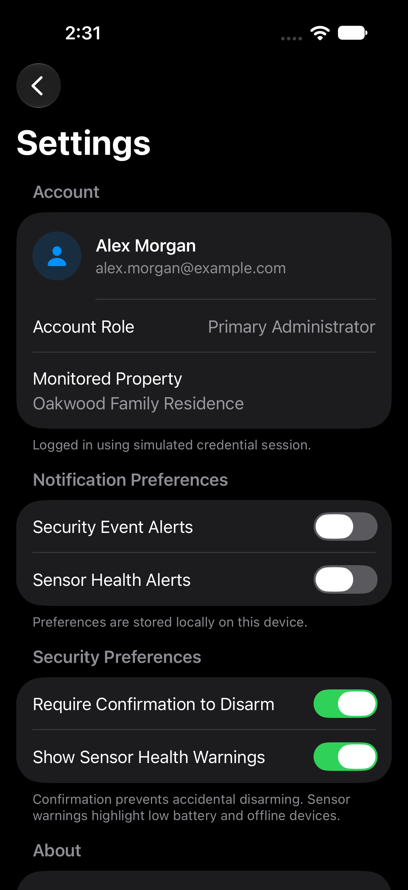

# Security Monitoring Companion (`SecurityCompanionDemo`)

A modern, offline-first iOS security monitoring companion application built with **SwiftUI**, **SwiftData**, and **Clean Architecture**. Designed and optimized for **iOS 17.0+** and **Xcode 16.0+**, the app delivers real-time zone monitoring, sensor telemetry, an asynchronous activity feed with offline caching, user preferences, and mock authentication.

---

## Table of Contents

- [Project Overview](#project-overview)
- [Key Features](#key-features)
- [Technology Stack & Requirements](#technology-stack--requirements)
- [Architecture Summary](#architecture-summary)
- [Getting Started](#getting-started)
  - [Prerequisites](#prerequisites)
  - [Open, Build, and Run in Xcode](#open-build-and-run-in-xcode)
  - [Running the XCTest Suite](#running-the-xctest-suite)
- [Mock Authentication & Credentials](#mock-authentication--credentials)
- [Simulator Screenshots](#simulator-screenshots)
- [Project Documentation](#project-documentation)

---

## Project Overview

The **Security Monitoring Companion** is an enterprise-grade mobile companion for residential and commercial security systems. It allows property owners and security administrators to:
1. Inspect the live security status of multiple zones across a property.
2. Control zone arming and disarming with safety confirmation dialogues.
3. Monitor connected sensor health (battery levels, connectivity status, and warnings).
4. Review security telemetry and event timelines via an asynchronous feed.
5. Operate seamlessly offline with persistent SwiftData storage and resilient fallback caching.

> [!NOTE]
> The remote event feed integrates with the free [JSONPlaceholder](https://jsonplaceholder.typicode.com/) mock REST API. Telemetry is deterministically mapped to simulated security events (motion detection, door contacts, system state changes) to provide realistic behavior without requiring physical security hardware.

---

## Key Features

- **Multi-Screen Navigation:** Uses SwiftUI's modern `NavigationStack` with structured transitions between Dashboard, Zone Details, Activity Feed, and Settings.
- **Security Dashboard:** High-level status overview (All Armed, All Disarmed, Partially Armed) with dynamic shield badges, zone status indicators, and quick action shortcuts.
- **Zone Details & Security Controls:** Zone-level arming and disarming logic backed by domain use cases. Includes safety confirmation prompts configurable via User Preferences.
- **Sensor Health Telemetry:** Real-time sensor indicators with visual battery gauges, battery warning thresholds (<20%), and sensor connectivity status (Online, Offline, Warning).
- **Asynchronous Activity Feed:** Fetches simulated events with Swift concurrency (`async/await`), supporting pull-to-refresh (`.refreshable`), skeleton/loading states, and dismissible transient error banners.
- **Offline-First Persistence:** Implemented with **SwiftData** (`@Model`, `@ModelActor`). Automatically seeds initial sample zones on first run, persists armed/disarmed state changes, and caches remote events for offline review.
- **User Settings & Preferences:** Account profile management, notification toggles, disarm confirmation controls, sensor health display options, and session sign-out.
- **Comprehensive Accessibility:** Full Dynamic Type support, custom battery indicator VoiceOver descriptions, grouped accessibility cards (`.accessibilityElement(children: .combine)`), and password show/hide toggles.

---

## Technology Stack & Requirements

| Component | Specification |
| :--- | :--- |
| **Operating System** | macOS 14.0+ (Sonoma) or macOS 15.0+ (Sequoia) |
| **IDE** | Xcode 16.0+ |
| **Minimum iOS Target** | iOS 17.0+ |
| **Language & Concurrency** | Swift 6 language mode / strict concurrency safe |
| **UI Framework** | SwiftUI (declarative UI with Observation framework: `@Observable`, `@Bindable`) |
| **Persistence Engine** | SwiftData (`ModelContainer`, `ModelContext`, `@ModelActor`) |
| **Networking** | Foundation `URLSession` with structured `async/await` |
| **Testing** | XCTest (59 Unit Tests + 2 UI Tests across 5 test suites) |
| **Dependencies** | Pure native Apple frameworks (Zero third-party package dependencies) |

---

## Architecture Summary

The project is structured according to **Clean Architecture** principles, enforcing strict separation of concerns and unidirectional data flow:

```
┌────────────────────────────────────────────────────────┐
│                   Presentation Layer                   │
│   SwiftUI Views  •  @Observable ViewModels (@MainActor)│
└───────────────────────────▲────────────────────────────┘
                            │
┌───────────────────────────┴────────────────────────────┐
│                      Domain Layer                      │
│   Entities  •  Repository Protocols  •  Use Cases      │
│          (Pure Swift • Zero External Dependencies)     │
└───────────────────────────▲────────────────────────────┘
                            │
┌───────────────────────────┴────────────────────────────┐
│                       Data Layer                       │
│   SwiftData Repositories (@ModelActor) • URLSession    │
│   DTOs & Deterministic Mappers • Persistent Cache      │
└────────────────────────────────────────────────────────┘
```

Dependency injection is managed centrally by `AppContainer`, which initializes SwiftData persistent stores, assembles use cases, and dispenses ViewModels to the presentation layer.

For an in-depth breakdown of layer responsibilities, persistence schemas, threading, and design patterns, see [ARCHITECTURE.md](ARCHITECTURE.md).

---

## Getting Started

### Prerequisites
- macOS running Xcode 16.0 or newer.
- An iOS 17.0+ Simulator runtime (e.g., iPhone 15, iPhone 16, or iPhone 18 Pro).

### Open, Build, and Run in Xcode

1. Clone the repository:
   ```bash
   git clone https://github.com/jendev87/IATP1621-SecurityCompanionDemo.git
   cd IATP1621-SecurityCompanionDemo
   ```
2. Open the Xcode project:
   ```bash
   open SecurityCompanionDemo.xcodeproj
   ```
3. In the Xcode toolbar, select the **SecurityCompanionDemo** scheme and target an active simulator (e.g. `iPhone 16` or `iPhone 18 Pro`).
4. Press **⌘R** (or click **Product > Run**) to build and launch the application.

### Running the XCTest Suite

The project includes unit and UI test suites verifying domain use cases, repository caching, view model state transitions, and SwiftData persistence.

To execute all tests within Xcode:
1. Press **⌘U** (or select **Product > Test**).

To run the complete test suite (both Unit and UI tests, 61 total tests) via the command line:
```bash
xcodebuild test \
  -scheme SecurityCompanionDemo \
  -destination 'platform=iOS Simulator,name=iPhone 16'
```

To run only the unit test suite (59 unit tests) for rapid validation:
```bash
xcodebuild test \
  -scheme SecurityCompanionDemo \
  -destination 'platform=iOS Simulator,name=iPhone 16' \
  -only-testing:SecurityCompanionDemoTests
```

---

## Mock Authentication & Credentials

The application uses an in-memory session manager (`AuthSessionManager`) pre-seeded with a default administrator account.

For convenience during development and grading, the login fields are pre-populated on initial launch:

| Field | Mock Value |
| :--- | :--- |
| **Email** | `alex.morgan@example.com` |
| **Password** | `password123` |
| **User Name** | Alex Morgan |
| **Role** | Primary Administrator |
| **Property** | Oakwood Family Residence |

To test authentication behavior:
- Tap **Sign In** to authenticate with the pre-filled credentials.
- Navigate to **Settings** and tap **Sign Out** to verify session teardown and return to the login screen.
- Enter invalid credentials (e.g., blank email or password) to view error validation states.

---

## Simulator Screenshots

| Screen | Preview |
| :--- | :---: |
| **Login Screen** |  |
| **Security Dashboard** |  |
| **Zone Details (Controls & Summary)** |  |
| **Zone Details (Sensor Telemetry)** |  |
| **Activity Feed** |  |
| **Settings & Preferences** |  |

---

Detailed project guides are provided in the repository root:
- [ARCHITECTURE.md](ARCHITECTURE.md) — Comprehensive technical architecture specification, data layer schemas, SwiftData model relationships, and concurrency choices.
- [WALKTHROUGH.md](WALKTHROUGH.md) — Step-by-step evaluator testing guide detailing all primary user journeys and verification steps.
